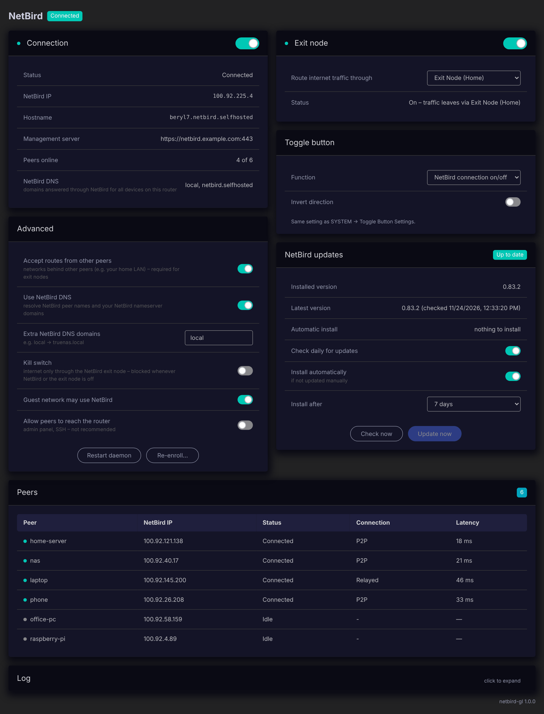
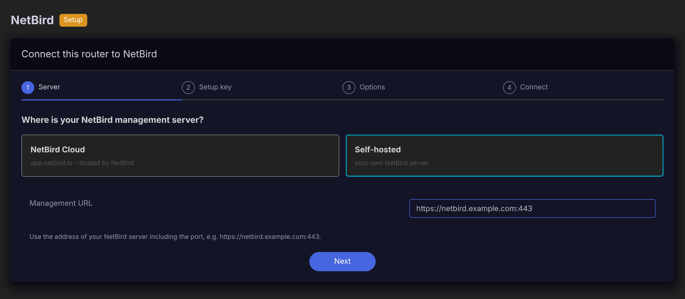

<div align="center">


# netbird-gl

**NetBird VPN for GL.iNet routers, managed from the GL admin panel**

[](../../releases/latest)
[](#-supported-devices)
[](https://netbird.io)
[](#-building-from-source)
[](LICENSE)

Enroll the router, connect and disconnect, route all traffic through an exit node,<br>
use the physical toggle switch and keep NetBird up to date without the command line.

[**Download**](../../releases/latest) · [**Install**](#-installation) · [**Features**](#-features) · [**Troubleshooting**](#-troubleshooting)



</div>

> [!NOTE]
> netbird-gl is an independent project. It is not affiliated with or endorsed
> by GL.iNet or NetBird.

## 📑 Table of contents

- [✨ Features](#-features)
- [📸 Screenshots](#-screenshots)
- [📟 Supported devices](#-supported-devices)
- [🚀 Installation](#-installation)
- [🧭 First setup](#-first-setup)
- [🌐 Exit node and toggle switch](#-exit-node-and-toggle-switch)
- [🔎 DNS](#-dns)
- [🧱 Kill switch](#-kill-switch)
- [🔄 Updates](#-updates)
- [💻 Command line](#-command-line)
- [🔒 Security](#-security)
- [🩺 Troubleshooting](#-troubleshooting)
- [🧹 Uninstall](#-uninstall)
- [🔧 How it works](#-how-it-works)
- [🧪 Building from source](#-building-from-source)
- [📄 License](#-license)

## ✨ Features

### Integration

| Feature | Description |
|---|---|
| 🧩 **Native GL page** | A *NetBird* page under **APPLICATIONS** in the GL admin panel. It follows the selected GL theme and uses the panel's login session. |
| 🧭 **Setup wizard** | Pick NetBird Cloud or a self-hosted server, paste a setup key, choose the options, connect. The wizard only runs on first setup. |
| 🔘 **Physical toggle switch** | Two entries in *SYSTEM → Toggle Button Settings*: **NetBird-VPN** and **NetBird-Exit-Node**. The direction can be inverted. |
| 📦 **Tiny package** | About 30 KB. The NetBird binary is downloaded during installation. |

### Connection

| Feature | Description |
|---|---|
| ⏻ **On / off** | Connect or disconnect from the panel, the toggle switch or SSH. The state survives reboots. |
| 🌍 **Exit node** | Route all internet traffic of the devices behind the router through a NetBird exit node chosen from a list. |
| 🛡️ **Kill switch** | Optional. Devices behind the router can only use the NetBird tunnel. They have internet only while NetBird and the exit node are on. |
| 👥 **Peers and log** | Every peer with its status, connection type (P2P / relayed) and latency, plus the NetBird log. |
| 🏠 **Guest network** | Choose whether the guest Wi-Fi may use NetBird. |

### DNS

| Feature | Description |
|---|---|
| 🔎 **NetBird DNS for the whole LAN** | Peer names and the match domains of your NetBird nameservers resolve on every device behind the router. |
| 🏷️ **Extra domains** | With a nameserver that has no match domains, extra domains (default `local`) are forwarded too, so e.g. `truenas.local` resolves. |
| 🤝 **Works with GL's DNS** | Everything else keeps using GL's DNS settings, including "Automatic", manual servers and AdGuard Home. |

### Maintenance

| Feature | Description |
|---|---|
| 🔔 **Update notice** | Daily check for new NetBird releases, with an *Update now* button. |
| ⏱️ **Automatic updates** | Immediately, or 1–30 days after a release appears. This can be turned off. |
| ✅ **Verified and reversible** | SHA256 check of every download. If the new version does not start, the previous one is restored. |
| ♻️ **Self-healing agent** | Keeps the connection and exit node in the chosen state, restores firewall rules after a reload and downloads NetBird again after a firmware upgrade. |
| 💾 **Firmware upgrades** | Settings and enrollment survive GL firmware upgrades done with *Keep Settings*. |

## 📸 Screenshots

<table>
  <tr>
    <td align="center"><b>Setup wizard</b></td>
    <td align="center"><b>Kill switch blocking traffic</b></td>
  </tr>
  <tr>
    <td></td>
    <td></td>
  </tr>
</table>

## 📟 Supported devices

| Device | Firmware | Status |
|---|---|---|
| GL.iNet **Beryl 7** (GL-MT3600BE) | 4.9.1 | ✅ Tested |
| Other GL.iNet routers with firmware 4.x and an arm64, armv7 or x86_64 CPU | 4.x | ⚠️ Should work, not tested |
| MIPS-based GL.iNet routers, firmware 3.x, stock OpenWrt (LuCI) | – | ❌ Not supported |

**Requirements**

- **Firmware:** GL.iNet 4.x, which uses the nginx admin panel with fcgiwrap.
  The installer checks for both.
- **Free space:** about 50 MB on the overlay for the NetBird binary.
- **Internet access** during installation, or see the offline install in [Installation](#-installation).
- **NetBird account:** NetBird Cloud or a self-hosted server, plus a **setup key**
  (*Setup Keys → Create Setup Key*). Giving the key a group such as `routers`
  makes access policies easier.

> [!TIP]
> Running it on another model? Please open an issue with the result. It helps
> grow the list above.

## 🚀 Installation

> [!IMPORTANT]
> Use GL firmware **4.9.1 or newer**. It fixes the GoodCloud vulnerability.

**1. Download** `netbird-gl-1.0.0.tar.gz` from the [latest release](../../releases/latest).
The checksums are in `SHA256SUMS`.

**2. Copy it to the router.** Replace `192.168.8.1` with your router's LAN
address. The SSH password is the admin panel password.

```sh
scp -O netbird-gl-1.0.0.tar.gz root@192.168.8.1:/tmp/
```

<sub>`-O` is needed because the router's SSH server (dropbear) has no SFTP.</sub>

**3. Install**

```sh
ssh root@192.168.8.1
cd /tmp && tar xzf netbird-gl-1.0.0.tar.gz && sh netbird-gl/install.sh
```

The installer:

1. downloads the latest NetBird release for the router's CPU and verifies its SHA256,
2. creates the `netbird` firewall zone, which rejects connections from NetBird to the router,
3. starts the `netbird` and `netbird-gl` services,
4. adds **APPLICATIONS → NetBird** and the two toggle switch entries,
5. removes insecure leftovers of devNalyx/netbird-openwrt, if it finds any,
6. finishes with a self-test of the page, the API and the GL session check.

**Upgrading:** run the installer of the newer version. You don't need to
uninstall first. Settings, enrollment and the NetBird binary are kept.

<details>
<summary><b>Offline install</b></summary>

1. Download `netbird_<version>_linux_arm64.tar.gz` and `netbird_<version>_checksums.txt`
   from the [NetBird releases](https://github.com/netbirdio/netbird/releases).
2. Copy both to `/tmp` on the router.
3. Run:

```sh
sh netbird-gl/install.sh --netbird-tar /tmp/netbird_0.83.2_linux_arm64.tar.gz \
                         --checksums  /tmp/netbird_0.83.2_checksums.txt
```

</details>

## 🧭 First setup

Open the GL admin panel → **APPLICATIONS → NetBird**. The wizard starts:

| Step | What to do |
|:---:|---|
| **1. Server** | **NetBird Cloud**, or **Self-hosted** with your server address, e.g. `https://netbird.example.com:443` |
| **2. Setup key** | Paste the setup key |
| **3. Options** | Peer routes, NetBird DNS, guest network, toggle switch function |
| **4. Connect** | The router enrolls and the dashboard opens |

Once the router is set up, a server outage never sends you back to the wizard.
The dashboard shows the status and waits for the connection to come back. To
move the router to another account or server, use **Advanced → Re-enroll…**.

## 🌐 Exit node and toggle switch

1. **Share an exit node.** In the NetBird dashboard, make a peer an exit node,
   for example a server at home: *Networks* or *Network Routes*. Its
   distribution groups must include the router's group.
2. **Select it on the router.** Pick it in the **Exit node** card. The switch in
   the card header turns it on and off.
3. **Assign the toggle switch** in the **Toggle button** card, or in
   *SYSTEM → Toggle Button Settings*:

   | Function | The switch turns on and off… |
   |---|---|
   | **NetBird-VPN** | the NetBird connection |
   | **NetBird-Exit-Node** | the selected exit node |

4. **Check it.** From a laptop behind the router, open <https://ipinfo.io>.
   It should show the exit node's public IP.

> [!NOTE]
> *Accept routes from other peers* must be on for exit nodes. It is on by default.

## 🔎 DNS

| Situation | What resolves through NetBird |
|---|---|
| *Use NetBird DNS* on | The NetBird peer domain (e.g. `nas.netbird.selfhosted`) and the match domains of your nameservers |
| Nameserver **without** match domains | Also the *Extra NetBird DNS domains*, default `local`, e.g. `truenas.local` |
| Everything else | GL's own DNS: "Automatic", manual servers or AdGuard Home |

- **What changes:** netbird-gl only adds a dnsmasq drop-in. GL's DNS settings are
  not touched.
- **Upstream list protected:** NetBird gets its own `/etc/resolv.conf`, so it
  cannot overwrite the upstream list that GL's "Automatic" mode uses.

## 🧱 Kill switch

With **Advanced → Kill switch** on, devices behind the router can only send
traffic into the NetBird tunnel:

| NetBird | Exit node | Internet for LAN devices |
|:---:|:---:|:---:|
| ✅ connected | ✅ on | ✅ through the exit node |
| ✅ connected | ❌ off | ❌ blocked (NetBird peers still reachable) |
| ❌ off or disconnected | – | ❌ blocked |

- **The router stays online** so NetBird can always reconnect. The admin panel
  and DNS keep working.
- **In the panel:** while traffic is blocked, the *Connection* card shows a red
  line.

## 🔄 Updates

| | |
|---|---|
| **Check** | About 10 minutes after boot and then daily |
| **Notice** | Shown in the panel, with an *Update now* button |
| **Automatic install** | Immediately or after 1, 3, 7 (default), 14 or 30 days, or off. The delay counts from the day the release was first seen, so days with the router off count too. |
| **Safety** | SHA256 verification. If the new version does not start, the previous one is restored. |
| **Firmware upgrades** | With *Keep Settings* the agent downloads NetBird again on its own. |

## 💻 Command line

Everything in the panel is also available over SSH:

```text
netbird-gl status                 state as JSON
netbird-gl up | down              connect / disconnect
netbird-gl exit on|off            exit node on / off
netbird-gl set key=value ...      change settings, e.g. kill_switch=1 dns_extra=local
netbird-gl update [latest]        install or update NetBird
netbird-gl dns-check [name]       explain DNS forwarding, optionally resolve a name
netbird-gl dns-reset              remove netbird-gl's DNS changes
netbird-gl set-password           use a dedicated password instead of the GL session
netbird-gl help                   all commands
```

## 🔒 Security

| Area | Protection |
|---|---|
| **API access** | An active GL admin session, checked against the router's own `/rpc`, or a dedicated password with a lockout |
| **CSRF** | Custom request header plus `Origin` / `Sec-Fetch-Site` checks |
| **Input** | Every value is validated against a whitelist |
| **Secrets** | No NetBird API token on the router. The setup key is passed in a temporary file (mode 600), never on the command line. |
| **Downloads** | TLS is always verified, and NetBird releases are checked against their SHA256 checksums |
| **Router exposure** | Connections from NetBird to the router are rejected (`netbird` firewall zone, `--block-inbound`, no SSH server). The router is not a routing peer. |
| **Web UI** | Strict Content-Security-Policy, `X-Frame-Options: SAMEORIGIN`, no inline scripts, no `innerHTML` |
| **Footprint** | No extra listening port. Everything goes through GL's nginx. |

## 🩺 Troubleshooting

<details>
<summary><b>"Your GL admin panel session has expired" keeps appearing</b></summary>

Switch to a dedicated password:

```sh
uci set netbird_gl.main.auth=password && uci commit netbird_gl
netbird-gl set-password
```
</details>

<details>
<summary><b>A name (e.g. <code>truenas.local</code>) does not resolve</b></summary>

```sh
netbird-gl dns-check truenas.local
```

The output shows what is forwarded where and tries the lookup through dnsmasq.
To remove netbird-gl's DNS changes, run `netbird-gl dns-reset`.
</details>

<details>
<summary><b>LAN devices have no internet</b></summary>

Check whether the **kill switch** is on. It blocks internet unless NetBird and
the exit node are both on. The *Connection* card shows a red line while it
blocks traffic.
</details>

<details>
<summary><b>Status and logs</b></summary>

```sh
netbird-gl status
netbird status -d
logread -e netbird
```
</details>

## 🧹 Uninstall

```sh
sh /usr/lib/netbird-gl/uninstall.sh            # keeps the NetBird binary and enrollment
sh /usr/lib/netbird-gl/uninstall.sh --purge    # removes everything
```

## 🔧 How it works

| Component | Path |
|---|---|
| NetBird daemon (procd) | `/etc/init.d/netbird`, state in `/etc/netbird` |
| netbird-gl agent (procd) | `/etc/init.d/netbird-gl` → `netbird-gl agent` |
| Command-line tool | `/usr/sbin/netbird-gl` |
| Web UI and CGI API | `/www/netbird-gl/`, `/usr/lib/netbird-gl/api.cgi`, served by `/etc/nginx/gl-conf.d/netbird-gl.conf` |
| Toggle switch hooks | `/etc/gl-switch.d/NetBird-VPN.sh`, `NetBird-Exit-Node.sh` |
| Configuration | `/etc/config/netbird_gl` |
| DNS drop-in | `/tmp/dnsmasq.d/netbird-gl.conf` |

**Known limitations**

- **Toggle switch entries.** GL builds sub-menus in *Toggle Button Settings* only
  for its own functions, so NetBird appears as two separate entries.
- **Checksums are not signatures.** NetBird's `checksums.txt` is not signed. It
  protects against corrupted downloads, not against a compromised GitHub
  release.
- **20-second status interval.** The agent checks the NetBird state every 20
  seconds.

## 🧪 Building from source

Requirements:

- BusyBox,
- shellcheck,
- Python 3,
- Node.js.

```sh
npm ci --prefix tools   # minifiers: terser, csso, html-minifier-terser
sh build.sh             # lint → tests → minified package → tests again
```

The build writes `dist/netbird-gl-<version>.tar.gz`, `.zip` and `SHA256SUMS`.
The test suite runs every script under BusyBox `ash`. External tools are mocked
(`uci`, `netbird`, `iptables`, `dnsmasq` and others), and so are the gaps of GL's
BusyBox (no `od`, `hexdump` or `find`).

## 📄 License

Released under the [MIT License](LICENSE).

<div align="center">
<sub>Made for GL.iNet routers · Powered by <a href="https://netbird.io">NetBird</a></sub>
</div>
