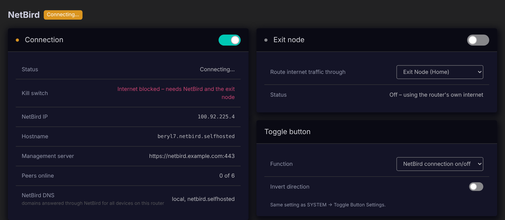

# netbird-gl

**NetBird for GL.iNet routers, managed from the GL admin panel.**

netbird-gl installs the [NetBird](https://netbird.io) client on a GL.iNet router
(firmware 4.x) and adds a **NetBird** page under *APPLICATIONS* in the GL admin
panel. You can enroll the router, connect and disconnect, route all traffic
through an exit node, use the physical toggle switch and keep NetBird up to
date without touching the command line.


> netbird-gl is an independent project. It is not affiliated with or endorsed
> by GL.iNet or NetBird.

## Features

- **Native look.** The page lives inside the GL admin panel, follows the
  selected GL theme and uses the panel's login session.
- **Setup wizard.** Choose NetBird Cloud or a self-hosted server, paste a setup
  key, pick the options and connect. The wizard only runs on first setup. After
  that a server outage keeps the dashboard and shows the status. To set up again,
  use *Re-enroll…*.
- **On/off** for the NetBird connection. The router remembers the state across
  reboots.
- **Exit node.** Route all internet traffic of the devices behind the router
  through a NetBird exit node, chosen from a list.
- **Physical toggle switch.** Two entries appear in *SYSTEM → Toggle Button
  Settings*:
  - **NetBird-VPN** turns the connection on and off,
  - **NetBird-Exit-Node** turns the selected exit node on and off.

  The direction can be inverted.
- **Kill switch (optional).** Devices behind the router can only use the
  NetBird tunnel. They have internet only while NetBird is connected and the
  exit node is on. The router itself stays online, so NetBird can always
  reconnect.
- **NetBird DNS for the whole LAN.**
  - Peer names (e.g. `nas.netbird.selfhosted`) and the match domains of your
    NetBird nameservers resolve for every device on the router.
  - With a nameserver that has no match domains, extra domains (default `local`)
    are forwarded too. This makes e.g. `truenas.local` work.
  - Everything else keeps using GL's DNS, so it works together with AdGuard Home.
- **NetBird updates.**
  - The router checks daily and shows a notice with an *Update now* button.
  - New releases can install automatically, immediately or after 1–30 days.
  - Every download is verified with SHA256, and the previous version is
    restored if the new one does not start.
- **Peers and log.** See every peer with its status, connection type and
  latency, plus the NetBird log.
- **Self-healing agent.**
  - Keeps the connection and exit node in the state you chose.
  - Restores NetBird's firewall rules after a firewall reload.
  - Downloads NetBird again after a firmware upgrade.
- **Survives firmware upgrades** done with *Keep Settings*.
- **Small:** the package is about 30 KB. The NetBird binary is downloaded during
  installation.

| Setup wizard | Kill switch active |
|---|---|
|  |  |

## Supported devices

| Device | Firmware | Status |
|---|---|---|
| GL.iNet **Beryl 7 (GL-MT3600BE)** | 4.9.1 | ✅ Tested |
| Other GL.iNet routers with firmware 4.x and an arm64, armv7 or x86_64 CPU | 4.x | ⚠️ Expected to work, not tested |
| MIPS-based GL.iNet routers, firmware 3.x, stock OpenWrt (LuCI) | – | ❌ Not supported |

Requirements:

- **Firmware:** GL.iNet 4.x, which uses the nginx-based admin panel with
  fcgiwrap. The installer checks for both.
- **Free space:** about 50 MB on the overlay for the NetBird binary.
- **Internet access** during installation, or the offline install described
  in [INSTALL.md](INSTALL.md).
- **A NetBird account and a setup key.** NetBird Cloud and self-hosted servers
  both work.

If you run it on another model, please open an issue with the result.

## Installation

Download `netbird-gl-1.0.0.tar.gz` from the
[latest release](../../releases/latest). Copy it to the router and run the
installer. Replace `192.168.8.1` with your router's address:

```sh
scp -O netbird-gl-1.0.0.tar.gz root@192.168.8.1:/tmp/
ssh root@192.168.8.1
cd /tmp && tar xzf netbird-gl-1.0.0.tar.gz && sh netbird-gl/install.sh
```

Open the GL admin panel → **APPLICATIONS → NetBird** and follow the wizard.

To **upgrade**, run the installer of the newer version. Settings and the
enrollment are kept. To **uninstall**:

```sh
sh /usr/lib/netbird-gl/uninstall.sh          # keeps NetBird and the enrollment
sh /usr/lib/netbird-gl/uninstall.sh --purge  # removes everything
```

[INSTALL.md](INSTALL.md) has step-by-step instructions, the offline install,
exit node setup and troubleshooting.

## Command line

Everything in the panel can also be done over SSH:

```text
netbird-gl status                 state as JSON
netbird-gl up | down              connect / disconnect
netbird-gl exit on|off            exit node on / off
netbird-gl set key=value ...      change settings (e.g. kill_switch=1)
netbird-gl update [latest]        install or update NetBird
netbird-gl dns-check [name]       explain DNS forwarding, optionally resolve a name
netbird-gl dns-reset              remove the dnsmasq drop-in
netbird-gl set-password           use a dedicated password instead of the GL session
```

## Security

- **API access.**
  - The panel's API requires an active GL admin session, checked against the
    router's own `/rpc` endpoint, or a dedicated password with a lockout.
  - Every request needs a custom header and a same-origin check, which protects
    against CSRF.
  - All input is validated against whitelists.
- **No NetBird API token** is stored on the router. Exit nodes are switched
  locally with `netbird networks select/deselect`.
- **Setup key** is passed to NetBird in a temporary file (mode 600), never on
  the command line.
- **Downloads.** Every download verifies TLS, and NetBird releases are checked
  against their SHA256 checksums.
- **Router not reachable from NetBird.** Connections from NetBird peers to the
  router are rejected: `netbird` firewall zone, `--block-inbound`,
  `--allow-server-ssh=false`. The router is not a routing peer
  (`--disable-server-routes`).
- **Web UI** uses a strict Content-Security-Policy, `X-Frame-Options:
  SAMEORIGIN`, no inline scripts and no `innerHTML`.
- **No extra listening port.** Everything goes through GL's nginx.

## How it works

| Component | Path |
|---|---|
| NetBird daemon (procd) | `/etc/init.d/netbird`, state in `/etc/netbird` |
| netbird-gl agent (procd) | `/etc/init.d/netbird-gl` → `netbird-gl agent` |
| Command-line tool | `/usr/sbin/netbird-gl` |
| Web UI and CGI API | `/www/netbird-gl/`, `/usr/lib/netbird-gl/api.cgi` (via `/etc/nginx/gl-conf.d/netbird-gl.conf`) |
| Toggle switch hooks | `/etc/gl-switch.d/NetBird-VPN.sh`, `NetBird-Exit-Node.sh` |
| Configuration | `/etc/config/netbird_gl` |
| DNS drop-in | `/tmp/dnsmasq.d/netbird-gl.conf` |

## Limitations

- **Toggle switch entries.** GL builds sub-menus in *Toggle Button Settings*
  only for its own functions, so NetBird appears as two separate entries.
- **Checksums are not signatures.** NetBird's `checksums.txt` is not signed. It
  protects against corrupted downloads, not against a compromised GitHub
  release.
- **Status checks run every 20 seconds.** The kill switch state in the panel
  and the reconnect logic follow the NetBird status at that interval.

## Building from source

Build requirements:

- BusyBox,
- shellcheck,
- Python 3,
- Node.js.

```sh
npm ci --prefix tools   # minifiers (terser, csso, html-minifier-terser)
sh build.sh             # lint, tests, minified package, tests again
```

The build writes `dist/netbird-gl-<version>.tar.gz`, `.zip` and `SHA256SUMS`.

The test suite in `tests/` runs every script under BusyBox `ash` against mocked
`uci`, `netbird`, `iptables`, `dnsmasq` and so on, including the gaps of GL's
BusyBox (no `od`, `hexdump` or `find`).

## License

[MIT](LICENSE)
